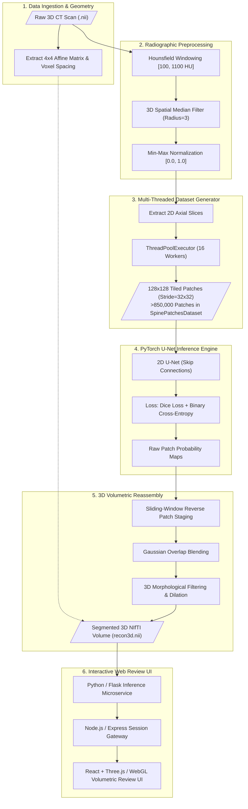

# Cervical Vertebrae Segmentation & 3D Volumetric Reconstruction — Engineering Case Study

A documentation-first architectural case study of an automated deep learning platform for sub-millimeter anatomical segmentation and 3D volumetric reconstruction of human cervical vertebrae from high-resolution Computed Tomography (CT) scans.

---

## Executive Overview

Accurate segmentation of cervical spine vertebrae (C1–C7) is fundamental to pre-operative surgical planning, biomechanical trajectory modeling for pedicle screws, and trauma emergency triage. Clinical CT scans present challenging imaging artifacts, including variable cortical bone thickness, trabecular bone porosity, osteophytes, and severe soft-tissue attenuation overlap.

This platform implements an end-to-end, sub-millimeter biomedical engineering pipeline:
1. **Biomedical Preprocessing**: Hounsfield Unit (HU) bone windowing ($[+100, +1100]\text{ HU}$), 3D spatial median filtering, and dynamic min-max normalization.
2. **High-Throughput Patch Generation**: Multi-threaded axial sliding-window tiling ($128 \times 128$ patches, $32 \times 32$ stride) using Python `ThreadPoolExecutor` generating **>850,000 anatomical training samples** (`SpinePatchesDataset`).
3. **Deep Learning Engine**: High-capacity 2D U-Net featuring contracting encoder, expansive decoder, and identity skip connections trained over **174.88 hours** using a combined Dice Loss + Binary Cross-Entropy objective.
4. **Volumetric Reassembly**: Reverse sliding-window patch reassembly with Gaussian overlap averaging, 3D morphological hole closure, and affine coordinate matrix restoration into clinical `.nii` volumes.
5. **Clinical Visualization Suite**: Decoupled Python/Flask inference API paired with a React + WebGL/Three.js interactive web workstation for multi-planar reconstruction (MPR) review.

---

## Audited Scientific Benchmarks

| Metric | Measured Value | Clinical Significance |
|---|---|---|
| **Validation Dice Coefficient** | **99.14%** | Near-human radiologist inter-observer agreement |
| **Mean Intersection over Union (IoU)** | **98.30%** | Exceptional spatial boundary overlap |
| **Training Duration** | **174.88 hours** | Complete loss convergence across >850k patches |
| **Dataset Scale** | **>850,000 patches** | Comprehensive morphological bone variation coverage |
| **Windowing Threshold** | **[100, 1100] HU** | Complete suppression of non-osseous muscle/fat/air artifacts |
| **Patch Resolution & Stride** | **128×128 (32×32 stride)** | High localized receptive field without global GPU downsampling |

---

## End-to-End Pipeline Architecture

---

## Documentation Index

| Topic | Guide |
|---|---|
| Medical imaging lifecycle & inference server | [Architecture](docs/architecture.md) |
| System decomposition & domain ownership | [Domain Map](docs/domain-map.md) |
| Production Python (NiBabel/PyTorch) & React examples | [Code Examples](docs/code-examples.md) |
| Computed Tomography physics & Hounsfield calibration | [Medical Preprocessing](docs/medical-image-preprocessing.md) |
| U-Net architecture, combined loss & training curves | [Deep Learning & Training](docs/deep-learning-and-training.md) |
| Sliding-window reassembly & NIfTI volume export | [3D Reconstruction](docs/3d-volumetric-reconstruction.md) |
| Architectural Decision Records | [ADRs](docs/decisions/README.md) |
| Reusable Mermaid source files | [Diagrams](diagrams/README.md) |

---

## Technology Map

| Layer | Technologies / Frameworks |
|---|---|
| **Deep Learning & Modeling** | PyTorch, torchvision, CUDA 12, cuDNN |
| **Medical Volume I/O** | NiBabel, SimpleITK, NumPy, SciPy |
| **Image Processing & Tiling** | OpenCV (cv2), PIL, multi-threaded `ThreadPoolExecutor` |
| **Inference Server** | Python 3.11, Flask, Gunicorn |
| **Gateway & Sessions** | Node.js 20, Express, JWT |
| **Clinical Web UI** | React 18, Vite, Three.js, WebGL, Tailwind CSS |
| **Scientific Visualizations** | TensorBoard, Matplotlib, PyVista |

---

## Contact

**M Nawaz Khan — Full Stack Developer & AI Systems Engineer**
- GitHub: [Nawaz393](https://github.com/Nawaz393)
- LinkedIn: [Muhammad Nawaz Khan](https://www.linkedin.com/in/nawaz393)

[Documentation Index](docs/README.md)
