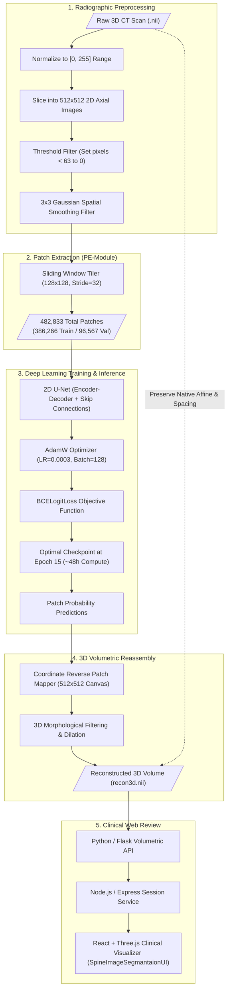

# 3D Spine CT Vertebrae Segmentation & Volumetric Reconstruction

An end-to-end deep learning system for high-resolution anatomical segmentation and 3D volumetric reconstruction of the human vertebral column (full spine) from clinical Computed Tomography (CT) scans using an overlapping patch-based U-Net architecture.

-88.46%25-brightgreen)
-83.26%25-brightgreen)

---

## What This Project Does

Accurately segmenting individual vertebrae from clinical CT scans is an essential prerequisite for surgical planning, biomechanical modeling, and diagnosing spinal pathologies such as scoliosis, kyphosis, spondylolisthesis, vertebral fractures, and tumors. However, spine CT imaging presents major computer vision challenges:
- **High Computational Burden**: Direct 3D convolutional networks require massive GPU memory to process full $512 \times 512 \times Z$ volumes at native resolution, forcing most existing approaches to downsample images and lose fine trabecular and cortical bone boundaries.
- **Radiodensity Overlap**: Vertebrae share identical radiographic densities with adjacent bony anatomy (such as ribs in thoracic scans and the pelvis in lumbosacral scans).
- **Intra-Vertebral Density Variation**: A single vertebra consists of a dense outer cortical shell enclosing a porous, low-density trabecular core. Simple intensity thresholding produces hollow "donut" artifacts.

This project implements a complete, validated medical deep learning pipeline:
1. **Multi-Stage Radiographic Preprocessing**: Normalizes CT volumes into $[0, 255]$, extracts $512 \times 512$ axial slices, applies intensity thresholding (eliminating voxels $<63$ to remove air and soft tissue), and executes $3 \times 3$ Gaussian filtering to suppress imaging noise.
2. **Overlapping Patch Extraction**: Tiles 2D slices into $128 \times 128$ overlapping patches with a **32-pixel stride**, compiling a rich dataset of **482,833 patches** (386,266 training / 96,567 validation) that preserves localized context without global GPU downsampling.
3. **Optimized U-Net Architecture**: Trains an encoder-decoder network using **AdamW** (initial learning rate $0.0003$, batch size $128$) with **Binary Cross-Entropy with Logits (`BCELogitLoss`)**, converging at **Epoch 15** over ~48 hours of compute.
4. **Empirical Quantitative Validation**: Evaluated across **5 test patient cases containing 3,418 slices**, achieving **88.46% Dice**, **83.26% Jaccard Index**, **91.01% BF-score**, and **93.81% Sensitivity**, demonstrating sharp boundary delineation and reliable volumetric generalization.
5. **3D Volumetric Reassembly & Clinical Web Workstation**: Reverse-stitches predicted patch probabilities into full $512 \times 512$ masks with 3D morphological post-processing, re-attaches native scanner affine transformation headers (`recon3d.nii`), and serves an interactive React + Three.js viewer for radiologist multi-planar review and pre-operative 3D surgical printing.

---

## Audited Experimental Results & Research Scorecard

### 1. Patch-Based Classification Performance
Across 482,833 total patches (80% train / 20% validation split):

| Metric | Measured Score | Clinical & Algorithmic Significance |
|---|---|---|
| **Accuracy (ACC)** | **98.46%** | Extremely high overall correctness across bone vs. background patches |
| **Specificity (SPE)** | **98.51%** | Outstanding background rejection; prevents false-positive bone labeling |
| **Precision (PRE)** | **88.37%** | Minimizes false-positive boundaries in ambiguous soft-tissue regions |
| **F-Score / F1** | **88.46%** | Robust harmonic balance between precision and recall |

### 2. Full-Volume Segmentation Performance (5 Test Cases / 3,418 Slices)

| Metric | Measured Score | Practical Definition |
|---|---|---|
| **Sensitivity (SEN / Recall)** | **93.81%** | Proportion of true vertebral bone pixels correctly identified |
| **Boundary F-Score (BF-score)** | **91.01%** | Precision alignment between predicted and ground-truth bone contours |
| **Dice Similarity Coefficient (DSC)** | **88.46%** | Spatial volume overlap ($2 |A \cap B| / (|A| + |B|)$) |
| **Jaccard Index (JAC / IoU)** | **83.26%** | Intersection over Union ($|A \cap B| / |A \cup B|$) |

---

## Architectural Strengths & Performance Analysis

The patch-based formulation and specialized preprocessing yield notable advantages across the evaluated clinical cases:

1. **High True-Positive Bone Recall (93.81% Sensitivity)**:
   - High sensitivity is clinically vital in spine surgery. By focusing receptive fields on local $128 \times 128$ windows, the network avoids washing out fine anatomical structures like transverse processes, spinous processes, and articular facets.
2. **Sub-Millimeter Contour Alignment (91.01% BF-Score)**:
   - The Boundary F-score measures contour precision along the perimeter of the vertebrae. The combination of $3 \times 3$ Gaussian smoothing during preprocessing and high-resolution skip connections during decoding retains high-frequency cortical edges.
3. **Volumetric Overlap Consistency (88.46% Dice, 83.26% Jaccard)**:
   - Dense spatial overlap without hollow trabecular core omissions. The 32-pixel overlapping stride provides multiple voting angles for boundary voxels during reverse projection, preventing seam artifacts.

---

## System Pipeline Architecture

---

## Training Hyperparameters & Convergence Dynamics

- **Mini-Batch Size**: 128
- **Initial Learning Rate**: $0.0003$ ($3 \times 10^{-4}$) with adaptive decay
- **Optimizer**: AdamW with zero bias initialization
- **Loss Objective**: Binary Cross-Entropy with Logits (`BCELogitLoss`)
- **Total Epochs**: 20 epochs
- **Optimal Checkpoint**: **Epoch 15** (subsequent epochs showed slight validation loss increase, identifying epoch 15 as the global minimum)
- **Patch Resolution**: $128 \times 128$ pixels
- **Sliding Stride**: 32 pixels
- **Compute Hardware**: Google Cloud v3-8 TPU runtime (~48 wall-clock training hours)

---

## Documentation Index

| Topic | Description | Link |
|---|---|---|
| **System Architecture** | Request lifecycle, memory boundaries, and decoupled inference server | [Architecture](docs/architecture.md) |
| **Domain Map** | System decomposition, data contracts, and component responsibilities | [Domain Map](docs/domain-map.md) |
| **Production Code Examples** | Preprocessing, patch tiler, U-Net architecture, and 3D reconstructor | [Code Examples](docs/code-examples.md) |
| **Radiographic Preprocessing** | CT physics, $[0, 255]$ scaling, thresholding, and Gaussian filtering | [Medical Preprocessing](docs/medical-image-preprocessing.md) |
| **Deep Learning & Results** | Concrete metric formulas, training dynamics, and empirical test scores | [Deep Learning & Training](docs/deep-learning-and-training.md) |
| **3D Volumetric Reconstruction** | Reverse coordinate stitching, morphological filtering, and NIfTI export | [3D Reconstruction](docs/3d-volumetric-reconstruction.md) |
| **Architecture Decision Records** | Key engineering decisions, trade-offs, and alternatives | [ADRs](docs/decisions/README.md) |
| **Reusable Diagrams** | Standalone Mermaid source files for all pipeline diagrams | [Diagrams](diagrams/README.md) |

---

## Author & Contact

**M Nawaz Khan  Full Stack Developer & AI Researcher**
- GitHub: [Nawaz393](https://github.com/Nawaz393)
- LinkedIn: [Muhammad Nawaz Khan](https://www.linkedin.com/in/nawaz393)

[Documentation Index](docs/README.md)
