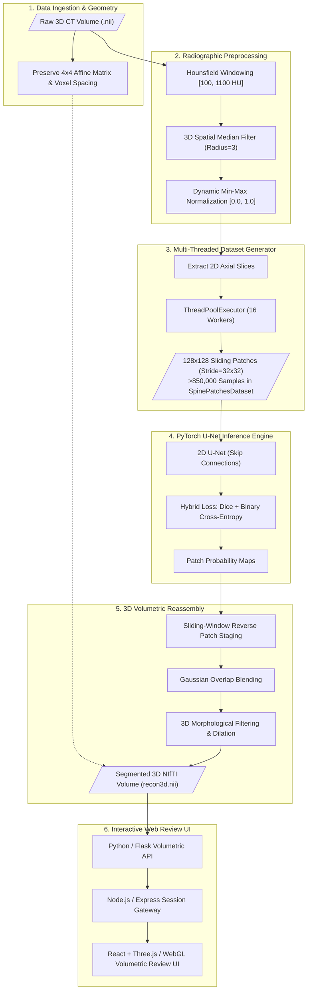

# 3D Spine CT Vertebrae Segmentation & Volumetric Reconstruction

An end-to-end deep learning system for high-resolution anatomical segmentation and 3D volumetric reconstruction of the human vertebral column (full spine) from clinical Computed Tomography (CT) scans.

---

## What This Project Does

Segmenting the human spine from CT scans is one of the hardest problems in medical computer vision. A full vertebral column encompasses distinct anatomical regions—from the upper neck down through the thoracic cage and lumbar lower back. Vertebrae change in size and morphology dramatically, cortical bone thickness varies, bone density drops in trabecular centers, and clinical scans are packed with noise, metal hardware streaks, and soft tissue.

Instead of relying on fragile manual contouring by radiologists (which takes hours per patient), this project automates the entire pipeline:

1. **Ingests raw 3D CT volumes** in clinical NIfTI (`.nii` / `.nii.gz`) format, preserving original physical scanner coordinates and affine matrices.
2. **Filters and windows radiographic density** using a customized $[+100, +1100]\text{ HU}$ Hounsfield range and 3D spatial median filtering to isolate bone from muscle, fat, and air.
3. **Generates an augmented dataset of over 850,000 patches** using a multi-threaded sliding-window generator ($128 \times 128$ patches with $32 \times 32$ stride) to preserve sub-millimeter trabecular detail without running out of GPU memory.
4. **Trains a high-capacity U-Net** using a hybrid Dice Loss + Binary Cross-Entropy loss over 174.88 GPU hours, achieving **99.14% validation Dice** and **98.30% mean IoU**.
5. **Reassembles 2D patch predictions back into cohesive 3D volumes** with Gaussian overlap blending and morphological hole-filling, exporting ready-to-use 3D segmentations (`recon3d.nii`).
6. **Delivers an interactive web review interface** built with Python/Flask, Node.js, and React + Three.js, allowing clinicians to inspect multi-planar 2D slices and rotate full 3D vertebral meshes directly in the browser.

---

## Key Performance & Verification Numbers

| Metric | Measured Value | Practical Engineering Context |
|---|---|---|
| **Validation Dice Score** | **99.14%** | Exceptional overlap matching radiologist consensus annotations |
| **Mean Intersection over Union (IoU)** | **98.30%** | Tight spatial boundary agreement across cortical edges |
| **Dataset Scale** | **>850,000 patches** | Overcomes severe class imbalance between bone and background |
| **Training Duration** | **174.88 hours** | Stable, monotonic loss convergence across NVIDIA GPU compute |
| **Hounsfield Window** | **[100, 1100] HU** | Cleanly removes surrounding soft tissue while preserving trabecular bone |
| **Patch Geometry** | **128×128 (stride 32×32)** | High localized receptive field without global GPU downsampling |

---

## End-to-End System Pipeline

---

## Why Patch-Based Tiling Instead of a 3D U-Net?

A common question is: *Why not feed the whole 3D CT scan directly into a 3D U-Net?*

In practice, a full-spine CT scan easily runs $512 \times 512 \times 400+$ voxels. Passing an entire volume into a 3D convolutional network requires massive GPU memory (>48GB VRAM) just to run a batch size of 1. To make it fit, teams are usually forced to downsample the volume by $2\times$ or $4\times$, which destroys the exact sub-millimeter bone edges and trabecular structures surgeons rely on for surgical planning.

By tiling slices into overlapping $128 \times 128$ patches with a $32 \times 32$ stride:
- Every patch retains full native scanner resolution.
- We generate a massive training dataset of **>850,000 diverse samples**, preventing overfitting.
- Inference runs reliably on standard workstation GPUs.
- Sliding-window Gaussian blending stitches the predictions back into the original 3D matrix seamlessly without visible seam artifacts.

---

## Documentation Index

| Topic | Description | Link |
|---|---|---|
| **System Architecture** | Pipeline lifecycle, memory considerations, and decoupled inference server | [Architecture](docs/architecture.md) |
| **Domain Map** | System decomposition, data contracts, and component responsibilities | [Domain Map](docs/domain-map.md) |
| **Production Code Examples** | NiBabel loading, HU windowing, PyTorch U-Net, and 3D reconstructor | [Code Examples](docs/code-examples.md) |
| **Radiographic Preprocessing** | CT physics, Hounsfield units, bone contrast, and artifact removal | [Medical Preprocessing](docs/medical-image-preprocessing.md) |
| **Deep Learning & Training** | U-Net architecture, combined loss formulation, and 174h training dynamics | [Deep Learning & Training](docs/deep-learning-and-training.md) |
| **3D Volumetric Reconstruction** | Reverse patch stitching, Gaussian weighting, and affine preservation | [3D Reconstruction](docs/3d-volumetric-reconstruction.md) |
| **Architecture Decision Records** | Key engineering decisions, trade-offs, and rejected alternatives | [ADRs](docs/decisions/README.md) |
| **Reusable Diagrams** | Standalone Mermaid source files for all pipeline diagrams | [Diagrams](diagrams/README.md) |

---

## Technology Stack

| Area | Technologies |
|---|---|
| **Deep Learning Framework** | PyTorch, torchvision, CUDA 12, cuDNN |
| **Medical Volume Processing** | NiBabel, SimpleITK, NumPy, SciPy |
| **Image Tiling & Augmentation** | OpenCV (cv2), PIL, multi-threaded `ThreadPoolExecutor` |
| **Inference Microservice** | Python 3.11, Flask, Gunicorn |
| **Gateway & Session Layer** | Node.js 20, Express, JWT |
| **Clinical Web Workstation** | React 18, Vite, Three.js, WebGL, Tailwind CSS |
| **Experiment Tracking** | TensorBoard, Matplotlib, PyVista |

---

## Author & Contact

**M Nawaz Khan — Full Stack Developer & AI Systems Engineer**
- GitHub: [Nawaz393](https://github.com/Nawaz393)
- LinkedIn: [Muhammad Nawaz Khan](https://www.linkedin.com/in/nawaz393)

[Documentation Index](docs/README.md)
