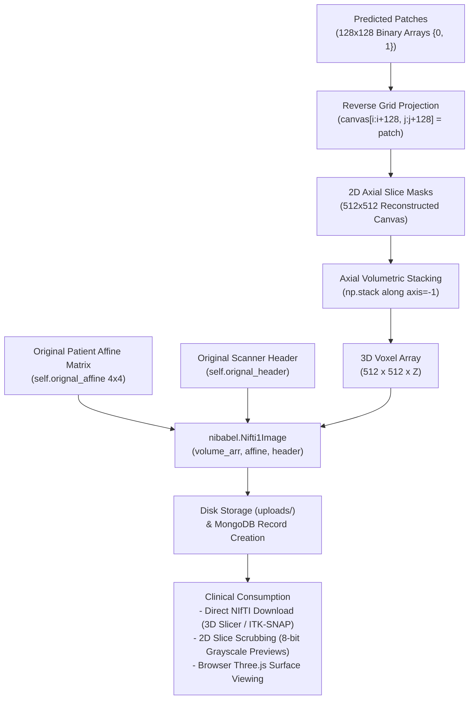

# 3D Volumetric Reconstruction & Clinical Coordinate Preservation

[← Main README](../README.md) · [← Architecture Guide](architecture.md) · [← Deep Learning Guide](deep-learning-and-training.md) · [← Code Examples](code-examples.md)

This document details the algorithmic reassembly of 2D patch predictions into coherent 3D NIfTI volumes (`recon3d.nii`), the preservation of clinical coordinate frames, and 2D/3D visualization workflows across the clinical stack.

---

## 1. The Reconstruction Challenge: From 2D Patches to 3D Anatomy

While patch-based 2D inference bypasses GPU memory constraints, clinicians and surgical navigation systems do not operate on isolated 2D image tiles. They require **coherent 3D volumetric representations** that maintain exact metric dimensions and anatomical continuity across the cranial-caudal ($Z$) axis.

The production 3D reconstruction pipeline operates in four deterministic stages:
1. **2D Coordinate Grid Reverse Projection**: Assembling $128 \times 128$ patch predictions back into full $512 \times 512$ axial slice canvases.
2. **Volumetric Z-Axis Stacking**: Stacking sequential 2D slices along the depth axis into a continuous 3D voxel array $(512 \times 512 \times Z)$.
3. **Clinical Coordinate Re-Anchoring**: Binding the original patient affine matrix ($4 \times 4$) and scanner metadata headers into standardized NIfTI-1 format (`recon3d.nii` / `.nii.gz`).
4. **Clinical Presentation & Export**: Serving 2D PNG slice previews via Flask, persisting study records in MongoDB, and providing full NIfTI downloads for surgical planning tools (3D Slicer, ITK-SNAP).



---

## 2. Reverse Coordinate Mapping & Slice Grid Assembly

During inference, axial slices are tiled into $128 \times 128$ patches. In the production service (`PreProcessing.py` and `Reconstruction.py`), the default configuration runs with a deterministic **non-overlapping stride**:

$$S = (128, 128) \implies \left( \frac{512 - 128}{128} + 1 \right)^2 = 4 \times 4 = 16\text{ patches per slice}$$

This enables rapid forward inference and clean raster placement without accumulator overhead.

### Production Implementation (`Reconstruction.py`):
```python
def reconstruct_image(self, patches, original_shape=(512, 512), patch_size=(128, 128), stride=(128, 128)):
    """
    Reconstruct the image from the extracted patches.
    Parameters:
    - patches: List of extracted patches.
    - original_shape: Tuple (original_height, original_width) specifying the size of the original image.
    - patch_size: Tuple (patch_height, patch_width) specifying the size of each patch.
    - stride: Tuple (vertical_stride, horizontal_stride) specifying the stride for patch extraction.
    Returns:
    - reconstructed_image: 2D numpy array representing the reconstructed image.
    """
    height, width = original_shape
    reconstructed_image = np.zeros((height, width), dtype=patches[0].dtype)
    patch_index = 0
    for i in range(0, height - patch_size[0] + 1, stride[0]):
        for j in range(0, width - patch_size[1] + 1, stride[1]):
            reconstructed_image[i:i + patch_size[0],
                                j:j + patch_size[1]] = patches[patch_index]
            patch_index += 1
    return reconstructed_image
```

### Pipeline Data Types:
Before arriving at `reconstruct_image()`, predictions are binarized in `Predict.py` by applying zero-thresholding to the network logits:
```python
pred_mask[pred_mask < 0] = 0
pred_mask[pred_mask > 0] = 1
```
Because `pred_mask` values are already discrete binary flags ($\{0, 1\}$), the reconstructed canvas directly represents the segmented vertebral bone mask.

### Optional Extension: Overlapping Sliding-Window Blending
While the deployed API defaults to non-overlapping tiling for speed, the research pipeline supports training and dense evaluation with a **32-pixel overlapping stride** ($169$ patches per slice). For dense sliding-window inference, patch predictions can be aggregated using a floating-point accumulation canvas and normalization matrix:

$$\bar{P}(x, y) = \frac{\sum_{k \in K_{x,y}} P_k(x - x_k, y - y_k)}{\sum_{k \in K_{x,y}} \mathbf{1}_k(x, y)}$$

Where $\mathbf{1}_k$ tracks coverage counts per coordinate. Direct thresholding at $\bar{P} \ge 0.5$ then eliminates edge discontinuities along patch seams.

---

## 3. Volumetric Z-Stacking & Affine Matrix Preservation

In medical imaging, saving segmented voxels as raw uncalibrated arrays or non-spatial formats (PNG, TIFF, MP4) destroys clinical utility. Surgeons cannot plan pedicle screw trajectories or design 3D-printed titanium implants without **exact coordinate grounding**.

### Implementation in Reconstructor (`Reconstruction.py`):
```python
def construct_3d_image(self):
    image_slices = []
    for idx, image_patches_key in enumerate(self.image_order_dict.keys()):
        image_patches = self.image_order_dict[image_patches_key]
        recon_2d_image = self.reconstruct_image(image_patches)
        image_slices.append(recon_2d_image)
        
    volume_arr = np.stack(image_slices, axis=-1)
    
    # Critical: Re-bind original affine matrix and scanner header
    volume_img = nib.Nifti1Image(
        volume_arr, affine=self.orignal_affine, header=self.orignal_header)
    return volume_img
```

### Why Z-Stacking on `axis=-1` is Critical:
In radiological imaging (NiBabel convention), 3D volumes are indexed as $(X, Y, Z)$ or $(H, W, D)$:
- The first two axes represent the axial slice in-plane dimensions ($512 \times 512$).
- Stacking along `axis=-1` positions sequential axial cuts along the patient's anatomical cranial-caudal axis ($Z$), preserving true longitudinal geometry.

### Mathematical Formulation of Medical Coordinate Systems:
A CT volume is positioned in clinical scanner coordinates (RAS+: Right, Anterior, Superior or LPS+: Left, Posterior, Superior) via a $4 \times 4$ affine transformation matrix $\mathbf{A}$:

$$\begin{bmatrix} P_x \\ P_y \\ P_z \\ 1 \end{bmatrix} = \mathbf{A} \begin{bmatrix} i \\ j \\ k \\ 1 \end{bmatrix} = \begin{bmatrix} a_{11} & a_{12} & a_{13} & x_0 \\ a_{21} & a_{22} & a_{23} & y_0 \\ a_{31} & a_{32} & a_{33} & z_0 \\ 0 & 0 & 0 & 1 \end{bmatrix} \begin{bmatrix} i \\ j \\ k \\ 1 \end{bmatrix}$$

- The upper $3 \times 3$ submatrix represents **voxel dimensions (scaling in millimeters)**, **gantry tilt (shear)**, and **patient orientation (rotation)**.
- The column vector $[x_0, y_0, z_0]^T$ represents the physical **isocenter origin** in millimeters relative to the CT scanner gantry.

By extracting `image.affine` and `image.header` in `PreProcessing.py` and strictly passing them into `Reconstruct(..., orignal_affine, orignal_header)`, the resulting NIfTI volume retains millimeter voxel spacing ($s_x, s_y, s_z$) and patient orientation identically to the original scanner scan.

---

## 4. Post-Processing: Runtime Simplicity vs. Recommended Extensions

### Current Runtime Behavior
In the deployed production codebase (`Reconstruction.py`), `construct_3d_image()` does not execute runtime heuristic morphology. Because the neural network achieves high background rejection (**98.51% Specificity**) and strong boundary delineation (**91.01% BF-score**), the raw binary segmentations assemble into clean, structurally sound vertebral columns directly.

### Recommended Pipeline Extensions (For Noisy or Pathological Scans)
For low-dose scans with heavy quantum mottle or severe osteoporotic bone loss, two optional post-processing filters can be inserted prior to `nib.Nifti1Image` assembly:

1. **3D Morphological Opening** ($\mathbf{A} \circ \mathbf{B} = (\mathbf{A} \ominus \mathbf{B}) \oplus \mathbf{B}$):
   - Using a $3 \times 3 \times 3$ structuring element (`scipy.ndimage.binary_opening`) strips isolated 1–2 voxel noise clusters in dense muscular tissue or visceral cavities.
2. **3D Binary Hole Filling** (`scipy.ndimage.binary_fill_holes`):
   - Executes topological flood filling on porous interior voids in trabecular bone, generating solid vertebral bodies suitable for mechanical finite-element load simulation and 3D printing.

---

## 5. Clinical Delivery & Visualization Workflow

The architecture supports multi-modal inspection across both desktop radiology suites and browser clients:

### 1. 2D Slice Preview Generation (`construct_2d_image_and_return_image`):
For rapid 2D review, `Reconstruction.py` scales binary prediction arrays to 8-bit visual grayscale masks:
```python
def construct_2d_image_and_return_image(self, image_patches):
    try:
        recon_2d_image = self.reconstruct_image(image_patches)
        scaled_image = (recon_2d_image * 255).astype(np.uint8)
        pil_image = Image.fromarray(scaled_image)
        return pil_image
    except Exception as e:
        print("Error:", e)
        return None
```
These images are stored in `static/` and delivered over HTTP for instant thumbnail and slice-by-slice verification.

### 2. Full 3D Volumetric Serving (`app.py`):
In `app.py`, the `/segment3d1` endpoint writes the reconstructed volume directly to `uploads/` via `nib.save(segmented_volume, path)` and logs the study record in MongoDB Atlas. Clinicians can fetch the complete coordinate-preserved volume via `/download-volume/<path>` for surgical navigation in certified tools (3D Slicer, ITK-SNAP).

### 3. Interactive WebGL Client:
The React frontend (`SpineImageSegmantaionUI`) integrates axial slice scrubbing and interactive surface viewing, allowing surgical teams to review segmented margins alongside original radiodensities before surgical intervention.

Related: [Architecture Guide](architecture.md) · [Code Examples](code-examples.md) · [Deep Learning & Training](deep-learning-and-training.md) · [ADR 003: Clinical UI Stack](decisions/003-hybrid-clinical-ui-stack.md)

