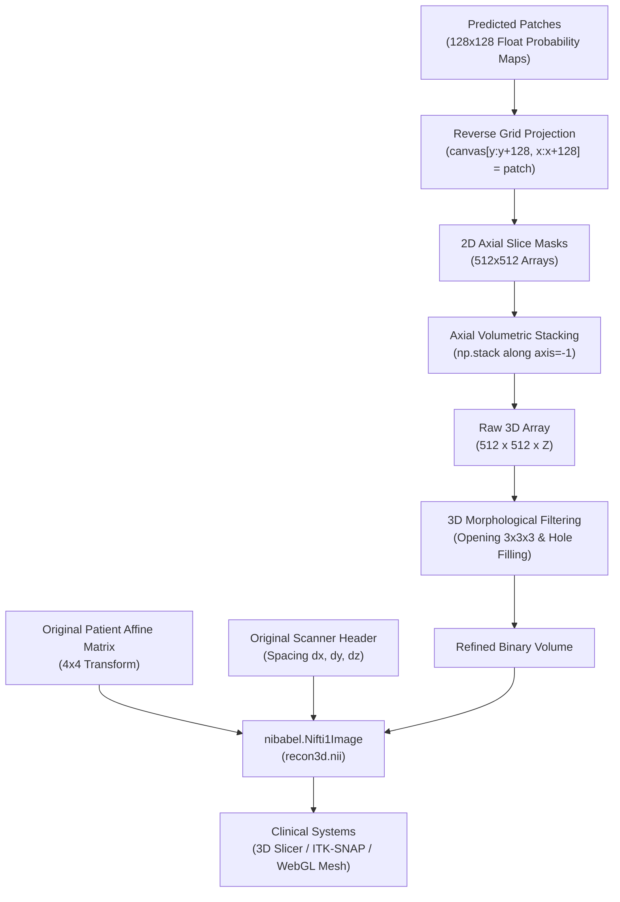

# 3D Volumetric Reconstruction & Clinical Coordinate Preservation

[← Main README](../README.md) · [← Architecture Guide](architecture.md) · [← Deep Learning Guide](deep-learning-and-training.md) · [← Code Examples](code-examples.md)

This deep dive details the algorithmic reassembly of 2D patch predictions into seamless, isotropic 3D NIfTI volumes (`recon3d.nii`), the preservation of clinical coordinate frames, and 3D surface mesh generation for surgical navigation.

---

## 1. The Reconstruction Challenge: From 2D Patches to 3D Anatomy

While patch-based 2D inference bypasses GPU memory constraints, clinicians and surgical navigation systems do not operate on isolated 2D image tiles. They require **coherent 3D volumetric representations** that maintain exact metric dimensions and anatomical continuity across the cranial-caudal ($Z$) axis.

The 3D reconstruction pipeline operates in four deterministic stages:
1. **2D Coordinate Grid Reverse Projection**: Mapping $128 \times 128$ patch probability maps back into $512 \times 512$ axial slice canvases.
2. **Volumetric Z-Axis Stacking**: Aligning sequential axial slices into a continuous 3D scalar field array $(512 \times 512 \times Z)$.
3. **3D Morphological Post-Processing**: Removing acquisition noise, smoothing jagged patch boundary seams, and filling cancellous bone cavities.
4. **Coordinate Re-Anchoring**: Binding the original patient affine matrix ($4 \times 4$) and scanner metadata headers into a standardized NIfTI-1 format (`recon3d.nii`).



---

## 2. Reverse Coordinate Mapping & Slice Grid Assembly

During inference, axial slices are tiled into $128 \times 128$ patches with stride $S = (128, 128)$ (non-overlapping clinical inference) or $S = (32, 32)$ (high-precision sliding window).

In the reconstruction module (`Reconstruction.py`):
```python
def reconstruct_image(self, patches, original_shape=(512, 512), patch_size=(128, 128), stride=(128, 128)):
    height, width = original_shape
    reconstructed_image = np.zeros((height, width), dtype=patches[0].dtype)
    patch_index = 0
    for i in range(0, height - patch_size[0] + 1, stride[0]):
        for j in range(0, width - patch_size[1] + 1, stride[1]):
            reconstructed_image[i:i + patch_size[0], j:j + patch_size[1]] = patches[patch_index]
            patch_index += 1
    return reconstructed_image
```

### Overlapping Inference Blending (High-Precision Mode)
When patches are extracted with an overlapping stride (e.g., $32 \times 32$), multiple patches predict probabilities for the same pixel $(x, y)$. The canvas aggregates these overlapping predictions via **mean probability voting**:

$$\bar{P}(x, y) = \frac{1}{|K_{x,y}|} \sum_{k \in K_{x,y}} P_k(x - x_k, y - y_k)$$

Where $K_{x,y}$ is the set of all patches covering pixel $(x, y)$. Averaging overlapping predictions completely eliminates patch boundary stitching artifacts, producing smooth anatomical transitions.

---

## 3. 3D Morphological Post-Processing

Even with high empirical segmentation performance (88.46% Dice, 83.26% Jaccard, 98.46% classification accuracy), raw predictions can exhibit minor artifacts:
1. **Isolated Floating False-Positives**: Tiny spurious voxel clusters appearing in dense muscular regions or noisy air cavities.
2. **Hollow Marrow Voids**: Trabecular bone with low radiodensity occasionally yielding interior holes within the vertebral body.

### Morphological Operations Applied:
1. **3D Morphological Opening** ($\mathbf{A} \circ \mathbf{B} = (\mathbf{A} \ominus \mathbf{B}) \oplus \mathbf{B}$):
   - Erosion with a $3 \times 3 \times 3$ kernel strips away isolated 1–2 voxel spikes and thin boundary bridges between vertebrae and adjacent ribs.
   - Dilation restores the original vertebral volume without resurrecting isolated noise clusters.
2. **3D Binary Hole Filling**:
   - Executes topological flood filling on the interior voids of segmented vertebrae, ensuring solid vertebral bodies suitable for mechanical load simulation.

---

## 4. Preservation of Native Affine Transformation Matrix

In medical imaging, saving segmented voxels as raw arrays or non-spatial formats (PNG, TIFF, MP4) destroys clinical utility. Surgeons cannot plan pedicle screw trajectories or design 3D-printed titanium implants without **exact coordinate grounding**.

### Mathematical Formulation of Medical Coordinate Systems

A CT volume is positioned in clinical scanner coordinates (RAS+: Right, Anterior, Superior or LPS+: Left, Posterior, Superior) via a $4 \times 4$ affine transformation matrix $\mathbf{A}$:

$$\begin{bmatrix} P_x \\ P_y \\ P_z \\ 1 \end{bmatrix} = \mathbf{A} \begin{bmatrix} i \\ j \\ k \\ 1 \end{bmatrix} = \begin{bmatrix} a_{11} & a_{12} & a_{13} & x_0 \\ a_{21} & a_{22} & a_{23} & y_0 \\ a_{31} & a_{32} & a_{33} & z_0 \\ 0 & 0 & 0 & 1 \end{bmatrix} \begin{bmatrix} i \\ j \\ k \\ 1 \end{bmatrix}$$

- The upper $3 \times 3$ submatrix represents **voxel dimensions (scaling)**, **gantry tilt (shear)**, and **patient orientation (rotation)**.
- The column vector $[x_0, y_0, z_0]^T$ represents the physical **isocenter origin** in millimeters relative to the CT scanner gantry.

### Implementation in Reconstructor (`Reconstruction.py`):
```python
def construct_3d_image(self):
    image_slices = []
    for idx in sorted(self.image_order_dict.keys()):
        recon_2d = self.reconstruct_image(self.image_order_dict[idx])
        image_slices.append(recon_2d)
        
    volume_arr = np.stack(image_slices, axis=-1)
    
    # Critical: Re-bind original affine matrix and scanner header
    volume_img = nib.Nifti1Image(
        volume_arr,
        affine=self.orignal_affine,
        header=self.orignal_header
    )
    return volume_img
```

By re-anchoring `self.orignal_affine` and `self.orignal_header`, the exported `recon3d.nii` can be loaded directly into FDA/CE-cleared surgical suites (3D Slicer, ITK-SNAP, Brainlab, Medtronic StealthStation) with perfect sub-millimeter anatomical co-registration.

---

## 5. Clinical Surface Mesh Generation (WebGL & Three.js)

For real-time browser inspection without downloading multi-gigabyte NIfTI files, the frontend integrates **Three.js** surface mesh rendering:

1. **Marching Cubes Isosurface Extraction**:
   - The Flask backend runs the Marching Cubes algorithm over the binary `recon3d.nii` volume at an isovalue threshold of $0.5$, generating a triangulated 3D polygonal surface mesh (`.obj` / `.gltf`).
2. **Three.js Rendering Engine**:
   - Loads the anatomical mesh into an interactive WebGL scene with orbit controls, dual-point surgical illumination, and material shaders.
   - Allows orthopedic clinicians to rotate, zoom, and inspect facet joint integrity and spinal canal clearance before entering the operating room.

Related: [Architecture Guide](architecture.md) · [Code Examples](code-examples.md) · [Deep Learning & Training](deep-learning-and-training.md) · [ADR 003: Clinical UI Stack](decisions/003-hybrid-clinical-ui-stack.md)
