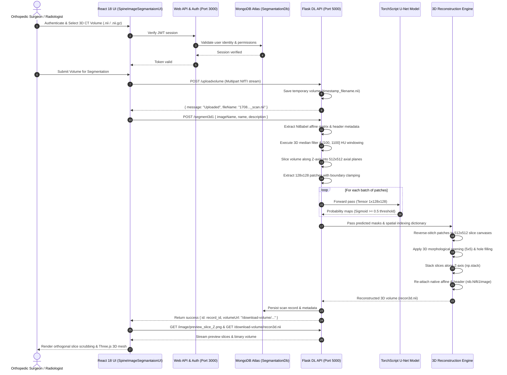
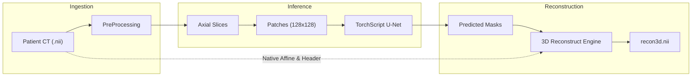

# System Architecture

[← Main README](../README.md) · [← Documentation Index](README.md) · [← Domain Map](domain-map.md)

This document provides a comprehensive architectural breakdown of the **Cervical Vertebrae Segmentation and 3D Volumetric Reconstruction** platform. It details the volumetric medical image processing lifecycle, the decoupled inference server architecture, component responsibilities, and clinical visualization integration.

---

## 1. Request and Data Lifecycle

The system coordinates volumetric medical imaging ingestion, tile-based tensor inference, coordinate-preserving 3D reconstruction, and interactive WebGL clinical delivery.

---

## 2. Component Responsibilities & Boundaries

The architecture is explicitly decomposed into distinct operational tiers, enforcing a clean separation between high-throughput tensor computing, clinical metadata persistence, and interactive visualization:

| Component | Technology | Primary Responsibilities | Concurrency & Fault Boundaries |
|---|---|---|---|
| **Clinical Presentation Tier** | React 18, Redux Toolkit, Three.js, Tailwind CSS | Orthogonal multi-planar slice scrubbing (axial, coronal, sagittal), ground-truth vs. prediction mask comparison, 3D anatomical mesh visualization, and file upload workflows. | Client-side execution in browser WebGL context; zero computational impact on server GPU resources. |
| **Web & Identity Tier** | Node.js, Express, Mongoose, JWT | Radiologist identity management, JWT signing/validation, historical study management, patient record association, and upload audit trails. | Asynchronous event loop; non-blocking database queries to MongoDB Atlas (`SegmantationDb`). |
| **Deep Learning Serving Tier** | Python Flask, Werkzeug, PyTorch 2.2, NiBabel | Volumetric file ingestion (`/uploadvolume`), input format validation (`validate_volume_data`), orchestration of 2D/3D pipelines (`controllers.py`), and binary download delivery. | CPU / CUDA bound; processes volumetric pipelines synchronously per request with fail-safe disk caching. |
| **Concurrent Preprocessing Engine** | `ThreadPoolExecutor`, SciPy, OpenCV | Hounsfield Unit bone isolation windowing ($[100, 1100]\text{ HU}$), 3D spatial median filtering, min-max intensity normalization, and boundary-clamped patch tiling. | Multi-threaded worker pool with mutex locking (`threading.Lock`) over global patch index counters. |
| **Neural Inference Engine** | PyTorch TorchScript (`torch.jit`) | Executing optimized tensor forward passes over $128 \times 128$ image patches using pretrained weights (`Single_SpineSegmentationv8.2_cpu.pth`). | Deterministic mathematical evaluation under `torch.no_grad()`, bypassing Python GIL via compiled TorchScript. |
| **3D Volumetric Reconstructor** | NumPy, NiBabel, SciPy Ndimage | Reverse coordinate grid assembly, 2D slice reconstruction, morphological post-processing, and native affine re-anchoring. | In-memory 3D array manipulation preserving exact spatial orientation and millimetric voxel dimensions. |

---

## 3. Decoupled Inference Architecture Rationale

Why separate the deep learning inference service (Flask + PyTorch) from the web application backend (Express + MongoDB)?

1. **Computational Heterogeneity**:
   - Deep learning inference on medical volumes is computationally heavy and memory-intensive (allocating multi-gigabyte NumPy arrays for 3D CT volumes).
   - Node.js excels at asynchronous I/O, session tokens, and metadata queries, but performs poorly on heavy synchronous tensor computations.
   - Isolating PyTorch within an independent Flask process ensures that intensive 3D reconstructions never block user authentication or clinical scan listing.

2. **Portability and TorchScript Deployment**:
   - Compiling the U-Net via `torch.jit` produces a portable TorchScript artifact (`Single_SpineSegmentationv8.2_cpu.pth`).
   - This decouples the deployed model from the exact Python training environment, enabling zero-overhead execution on commodity clinical CPUs (e.g., standard hospital radiology workstations) or hardware-accelerated CUDA servers without retraining.

3. **Coordinate Integrity and Native Affine Preservation**:
   - Traditional web servers discard DICOM/NIfTI header metadata, outputting generic PNG or JPEG image sequences.
   - In orthopedic spine surgery, spatial coordinates (voxel spacing $s_x, s_y, s_z$, origin $x_0, y_0, z_0$, and RAS/LPS orientation) are clinically sacred. Discarding them renders 3D reconstructions unusable for surgical drill guides or robotic pedicle screw navigation.
   - The Flask pipeline explicitly reads `nibabel.Nifti1Image.affine` and `header` on ingestion, passes them alongside the inference stream, and re-attaches them during 3D reassembly.

---

## 4. Execution Pipeline Topology

Related: [Domain Map](domain-map.md) · [Code Examples](code-examples.md) · [Preprocessing Deep Dive](medical-image-preprocessing.md) · [ADR 001: Patch-Based U-Net](decisions/001-patch-based-vs-full-3d-unet.md)
