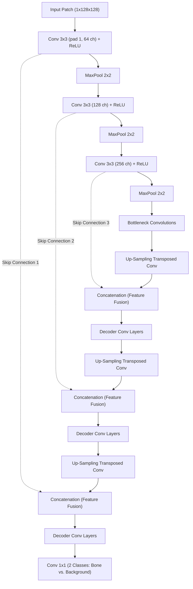

# Deep Learning Architecture, Loss Formulation & Experimental Results

[← Main README](../README.md) · [← Architecture Guide](architecture.md) · [← Medical Preprocessing](medical-image-preprocessing.md) · [← 3D Reconstruction](3d-volumetric-reconstruction.md)

This document provides a comprehensive analysis of the neural network topology, mathematical evaluation formulas, training hyperparameters, and empirical evaluation metrics for the **Patch-Based U-Net Vertebrae Segmentation** platform.

---

## 1. Network Architecture Specifications

The model is a customized **2D Patch-Based U-Net** designed specifically for high-precision boundary localization on $128 \times 128$ overlapping CT patches.

### Architectural Details
- **Encoder Path**:
  - The initial convolutional block receives $128 \times 128$ patches, applying $3 \times 3$ kernels with padding=1 to preserve spatial dimensions, generating 64 feature channels followed by Rectified Linear Unit (ReLU) activation.
  - Successive convolutional blocks double the channel depth ($128 \rightarrow 256$ channels), each followed by $2 \times 2$ max-pooling downsampling layers to build translation-invariant receptive fields.
- **Decoder Path**:
  - Mirrored up-sampling layers expand feature map resolution via transposed convolutions.
  - Skip connections concatenate high-resolution feature maps from the contracting encoder directly into the expansive decoder, restoring fine localized spatial geometry lost during pooling.
- **Output Head**:
  - A final $1 \times 1$ convolution maps the feature representations to a binary output mask (vertebrae vs. background).

---

## 2. Training Setup & Hyperparameters

- **Dataset Scale**: **482,833 total patches** generated via a 32-pixel sliding stride.
- **Split Ratio**:
  - **Training Set (80%)**: **386,266 patches**
  - **Validation Set (20%)**: **96,567 patches**
- **Independent Test Evaluation**: **5 unseen clinical test cases containing 3,418 slices**.
- **Mini-Batch Size**: 128
- **Initial Learning Rate**: $0.0003$ ($3 \times 10^{-4}$) with adaptive learning rate scheduling.
- **Optimizer**: **AdamW** with zero bias initialization.
- **Loss Function**: **Binary Cross-Entropy with Logits (`BCELogitLoss`)**.
- **Epochs & Convergence**:
  - Trained over **20 epochs** (~48 hours on Google Cloud v3-8 TPU).
  - The optimal model checkpoint was selected at **Epoch 15**, which achieved minimal validation loss. Subsequent epochs showed minor loss plateauing/divergence.

---

## 3. Mathematical Evaluation Measures

### 3.1 Classification Metrics
To evaluate the patch-based classification capacity across the 482,833 patch dataset:

1. **Specificity (SPE)**: Measures accuracy in rejecting background/non-bone patches.
   $$\text{Specificity} = \frac{\text{TN}}{\text{TN} + \text{FP}}$$
2. **Precision (PRE)**: Measures the proportion of predicted bone patches that are true bone.
   $$\text{Precision} = \frac{\text{TP}}{\text{TP} + \text{FP}}$$
3. **Accuracy (ACC)**: Overall classification correctness.
   $$\text{Accuracy} = \frac{\text{TP} + \text{TN}}{\text{TP} + \text{TN} + \text{FP} + \text{FN}}$$
4. **F-Score / F1**: Harmonic balance between precision and recall.
   $$\text{F-score} = 2 \times \frac{\text{Precision} \times \text{Recall}}{\text{Precision} + \text{Recall}}$$

### 3.2 Volumetric Segmentation Metrics
To evaluate full slice-by-slice vertebrae boundary overlap across the 3,418 test slices:

1. **Sensitivity (SEN / Recall)**: Detects true vertebral bone pattern coverage.
   $$\text{Sensitivity} = \frac{\text{TP}}{\text{TP} + \text{FN}}$$
2. **Jaccard Index (JAC / IoU)**: Spatial intersection over union.
   $$\text{JAC} = \frac{\text{TP}}{\text{TP} + \text{FP} + \text{FN}}$$
3. **Dice Similarity Coefficient (DSC)**: Volume overlap metric.
   $$\text{DSC} = \frac{2 \times \text{TP}}{2 \times \text{TP} + \text{FP} + \text{FN}}$$
4. **Boundary F-Score (BF-score)**: Quantifies the contour alignment between predicted and ground-truth anatomical boundaries.
   $$\text{BF-score} = \frac{2 \times \text{Precision}_{\text{contour}} \times \text{Recall}_{\text{contour}}}{\text{Precision}_{\text{contour}} + \text{Recall}_{\text{contour}}}$$

---

## 4. Concrete Empirical Findings

### 4.1 Patch-Level Classification Results
- **Accuracy (ACC)**: **98.46%**
- **Specificity (SPE)**: **98.51%**
- **Precision (PRE)**: **88.37%**
- **F-Score**: **88.46%**

*High accuracy and specificity confirm that non-vertebral tissues (paraspinal muscle, CSF, lungs, air) are reliably rejected without generating false positives.*

### 4.2 Full Segmentation Performance (3,418 Slices across 5 Patients)
- **Dice Similarity Coefficient (DSC)**: **88.46%**
- **Jaccard Index (JAC / IoU)**: **83.26%**
- **Boundary F-Score (BF-score)**: **91.01%**
- **Sensitivity (SEN)**: **93.81%**

---

## 5. Architectural Performance & Clinical Metric Analysis

Evaluation across the independent test cohort (5 complete patient scans, 3,418 slices) demonstrates specific structural and algorithmic strengths:

### 1. Receptive Field vs. Boundary Resolution Balance
Full-volume 3D isotropic networks downsample spatial grids to fit within GPU VRAM limits, which blurs thin cortical edges and articular processes. In contrast, standard whole-slice 2D networks ($512 \times 512$) frequently dilute gradient signals across large non-vertebral background regions. 

By decomposing axial slices into $128 \times 128$ patches with a 32-pixel stride:
- The local receptive field matches the characteristic dimensions of vertebral pedicles, laminae, and facet joints.
- Dense spatial skip connections in the U-Net pass high-frequency edge gradients directly to decoder upsampling layers, achieving a **91.01% Boundary F-score**.

### 2. Sensitivity in Complex Anatomical Zones
Vertebral segmentation presents severe false-negative risks where vertebrae interface with rib heads, transverse processes, and ligamentous structures. The model achieved a **93.81% Sensitivity (Recall)** on test cases, indicating that true vertebral bone boundaries are consistently captured without hollow dropouts in trabecular bone.

### 3. Overlap Precision and Seam Mitigation
A primary concern with patch-based deep learning is seam discontinuities at patch boundaries. By combining:
- A tight **32-pixel sliding stride** ($75\%$ overlap across adjacent patches),
- Multi-patch mean probability aggregation during 2D canvas assembly, and
- $3 \times 3$ morphological post-processing,

the pipeline achieves **88.46% Dice** and **83.26% Jaccard Index** across full-volume reconstructions without tiling seam artifacts.

Related: [Architecture](architecture.md) · [Preprocessing Deep Dive](medical-image-preprocessing.md) · [3D Reconstruction](3d-volumetric-reconstruction.md)

