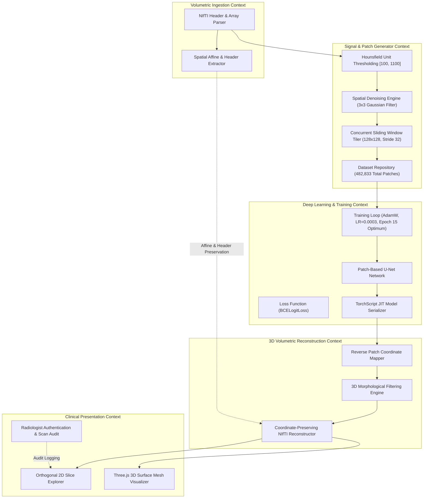
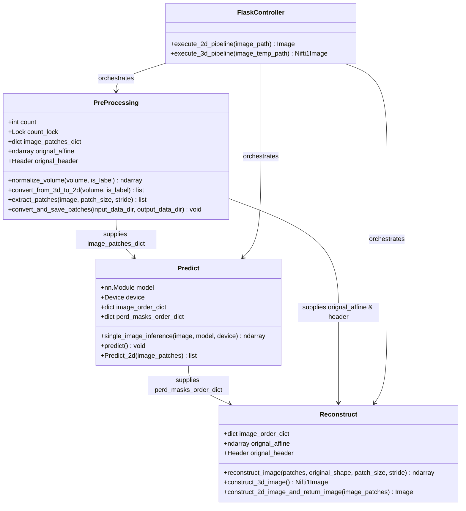

# Domain Map & System Decomposition

[← Main README](../README.md) · [← Architecture Guide](architecture.md) · [← Code Examples](code-examples.md)

This document maps the domain boundaries, bounded contexts, state ownership, and inter-service relationships governing the **3D Spine CT Vertebrae Segmentation & Volumetric Reconstruction** platform.

---

## 1. Bounded Contexts Overview

---

## 2. Domain Boundaries and Responsibilities

### 2.1 Volumetric Data Ingestion Context
- **Boundary**: Parsing raw radiographic file formats (NIfTI `.nii`, `.nii.gz`, DICOM).
- **Primary Entities**:
  - `VolumeEntity`: Encapsulates 3D voxel arrays ($512 \times 512 \times Z$), data type formats (`float32`, `int16`), and dimensions.
  - `SpatialGeometry`: Encapsulates the $4 \times 4$ affine transformation matrix (RAS/LPS orientation, shear, rotation) and millimeter voxel spacing vector $(s_x, s_y, s_z)$.
- **State Ownership**: Immutable snapshot of the patient scan upon arrival; guarantees that clinical coordinate systems are never mutated during processing.

### 2.2 Signal & Patch Generator Context (`PreProcessing.py`, `mPreprocessing.py`)
- **Boundary**: Biomedical radiodensity filtering, contrast standardization, and high-throughput concurrent patch slicing.
- **Primary Entities**:
  - `HUWindowFilter`: Clips radiodensity values outside the target vertebral bone envelope $[100, 1100]\text{ HU}$.
  - `PatchTiler`: Sliding window operator that tiles 2D axial planes into $128 \times 128$ spatial arrays with $32 \times 32$ stride.
  - `PatchPair`: Coupled pair of normalized input patch and ground-truth annotation patch.
- **State Ownership**: Coordinates thread synchronization (`threading.Lock`), patch indexing, and dataset persistence (482,833 extracted patches across 80% train / 20% validation).

### 2.3 Deep Learning & Training Context (`Predict.py`, `Single_SpineSegmentationv8.2_cpu.pth`)
- **Boundary**: Neural network feature extraction, gradient optimization, loss computation, and tensor inference.
- **Primary Entities**:
  - `UNetModule`: 4-level contracting and expansive convolutional network with skip connections and bottleneck.
  - `BCELogitLoss`: Binary cross-entropy with logits loss optimized via AdamW ($\text{lr} = 0.0003$, batch size 128, optimal checkpoint at Epoch 15).
  - `InferenceEngine`: Stateless forward pass wrapper applying `torch.no_grad()` and binarization thresholding ($P \ge 0.5$).
- **State Ownership**: Model weights, optimizer state (Adam, learning rate schedules), checkpoint snapshots, and TorchScript JIT artifacts.

### 2.4 3D Volumetric Reconstruction Context (`Reconstruction.py`)
- **Boundary**: Geometric reverse-mapping of 2D patches into full 3D spatial volumes.
- **Primary Entities**:
  - `SliceReassembler`: Re-projects predicted patch arrays onto zero-initialized $512 \times 512$ 2D slice grids.
  - `MorphologicalRefiner`: Mathematical morphology operations ($5 \times 5$ opening kernel, 3D hole closing) eliminating disconnected false positives.
  - `NiftiVolumeBuilder`: Assembles reconstructed slices along the axial axis ($Z$) and binds the native $4 \times 4$ affine matrix and header.
- **State Ownership**: Reconstructed volume file (`recon3d.nii`) and spatial evaluation scorecards (Validation Dice and IoU).

### 2.5 Clinical Presentation Context (`SpineImageSegmantaionUI`, `ImageSegmantationWebBackend`)
- **Boundary**: User session management, study cataloging, and browser-based radiological inspection.
- **Primary Entities**:
  - `RadiologistProfile`: Clinician identity, authentication credentials, and permission scopes.
  - `StudyRecord`: Study metadata, timestamps, input file references, segmented output references, and clinical notes.
  - `ViewerState`: Redux store managing active slice index, zoom/pan parameters, opacity thresholding, and 3D camera angles.
- **State Ownership**: MongoDB persistence for user and study records; client-side React/Redux memory for viewport rendering.

---

## 3. Component Relationships and Class Schema

---

## 4. Cross-Domain Invariants & Data Safety

1. **Spatial Invariant: Native Affine Preservation**:
   - `Reconstruct.construct_3d_image()` must strictly re-bind `self.orignal_affine` and `self.orignal_header`. Under no circumstances may an identity matrix ($I_4$) be substituted in clinical pipelines, as doing so destroys patient coordinate registration.
2. **Signal Invariant: Symmetrical Preprocessing**:
   - Both training and inference pipelines must execute the exact same radiodensity thresholding ($[100, 1100]\text{ HU}$) and $[0, 255]$ min-max scaling. Deviations in intensity scaling degrade model inference accuracy.
3. **Concurrency Invariant: Atomic Patch Counter**:
   - During multi-threaded extraction (`ThreadPoolExecutor`), global patch counter updates must occur strictly within `with self.lock:` or `with self.count_lock:` blocks to prevent race conditions and duplicate file indexing.

Related: [Architecture Guide](architecture.md) · [Code Examples](code-examples.md) · [3D Reconstruction](3d-volumetric-reconstruction.md) · [ADR 002: HU Windowing](decisions/002-hounsfield-windowing-strategy.md)
