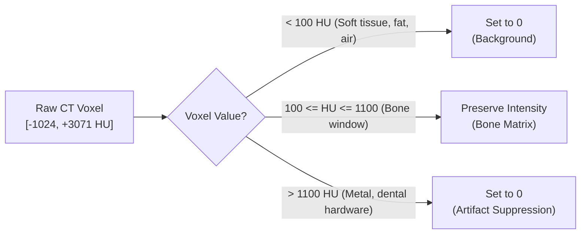

# Medical Image Preprocessing & Radiographic Physics

[← Main README](../README.md) · [← Architecture Guide](architecture.md) · [← Deep Learning Guide](deep-learning-and-training.md)

This deep dive examines the biomedical signal processing principles, CT physics, radiodensity calibrations, and spatial tiling algorithms that underpin the preprocessing pipeline in `PreProcessing.py` and `mPreprocessing.py`.

---

## 1. Computed Tomography Physics & The Hounsfield Unit Scale

Computed Tomography (CT) measures the linear X-ray attenuation coefficient ($\mu$) of anatomical tissues as an X-ray beam traverses the human body. To establish manufacturer-agnostic calibration across scanner hardware (GE, Siemens, Philips, Toshiba), raw attenuation values are normalized relative to distilled water and air under standard temperature and pressure into **Hounsfield Units (HU)**:

$$HU = 1000 \times \frac{\mu_{\text{tissue}} - \mu_{\text{water}}}{\mu_{\text{water}} - \mu_{\text{air}}}$$

### Radiodensity Spectrum Across Human Tissues

| Tissue Type | Radiodensity Range (HU) | Radiographic Appearance | Preprocessing Treatment in Pipeline |
|---|---|---|---|
| **Air** | $-1000\text{ HU}$ | Absolute black | Suppressed to `0` |
| **Lung Parenchyma** | $-600\text{ to } -400\text{ HU}$ | Dark gray | Suppressed to `0` |
| **Fat / Adipose Tissue** | $-120\text{ to } -60\text{ HU}$ | Dark gray | Suppressed to `0` |
| **Water / CSF** | $0\text{ to } +15\text{ HU}$ | Medium dark gray | Suppressed to `0` |
| **Soft Tissue & Paraspinal Muscle** | $+35\text{ to } +55\text{ HU}$ | Intermediate gray | Suppressed to `0` ($<100\text{ HU}$ cutoff) |
| **Cartilage & Intervertebral Discs** | $+50\text{ to } +90\text{ HU}$ | Light gray | Suppressed to `0` ($<100\text{ HU}$ cutoff) |
| **Trabecular (Cancellous) Bone** | $+150\text{ to } +400\text{ HU}$ | Porous white | **Retained in Bone Window** |
| **Cortical (Compact) Bone** | $+700\text{ to } +1500\text{ HU}$ | Bright hyperdense white | **Retained in Bone Window** (capped at 1100 HU) |
| **Dental Implants & Surgical Hardware** | $>+2000\text{ to } +3000\text{ HU}$ | Saturated flare artifacts | Suppressed to `0` ($>1100\text{ HU}$ cutoff) |

---

## 2. Radiographic Challenges in Spinal Vertebrae Imaging

Segmenting the full vertebral column (cervical, thoracic, and lumbar vertebrae) presents four distinct radiographic failure modes for traditional computer vision:

1. **Intra-Vertebral Density Heterogeneity**:
   - Every vertebra consists of an outer shell of hyperdense **cortical bone** ($>700\text{ HU}$) encasing a porous core of **trabecular bone** ($150–350\text{ HU}$). Simple intensity thresholding creates hollow "donut" masks that fail to segment the vertebral body, pedicles, and spinous processes.
2. **Neighboring Rib & Pelvic Bony Contiguity**:
   - In thoracic slices, ribs articulate directly with transverse processes and costal facets. In lumbar and sacral regions, the spine connects to the pelvis. These adjacent non-vertebral bones exhibit identical radiodensity ($>800\text{ HU}$), defeating connected-component algorithms.
3. **Beam Hardening & Metallic Artifacts**:
   - High-density surgical pedicle screws, titanium cages, dental amalgams, and dense shoulder musculature cause photon starvation, producing severe streak artifacts across spinal scans.
4. **Partial Volume Effects**:
   - In CT acquisition with slice thickness $\ge 1.0\text{ mm}$, voxels spanning bone-soft tissue boundaries average the two densities, creating blurred interfaces at facet joints, neural foramina, and intervertebral discs.

---

## 3. The Bone Windowing Strategy: $[100, 1100]\text{ HU}$

To isolate spinal bony tissue while rejecting noise and surrounding anatomy, the preprocessing engine applies a calibrated radiodensity window:

```python
# Radiodensity windowing formulation (PreProcessing.py)
min_hu = 100
max_hu = 1100
volume = np.where((volume >= min_hu) & (volume <= max_hu), volume, 0)
```



### Rationale for Window Boundaries:
- **Lower Threshold ($100\text{ HU}$)**:
  - Dense paraspinal muscles (trapezius, sternocleidomastoid, scalenes) peak around $50–65\text{ HU}$. Setting the gate at $100\text{ HU}$ completely eliminates muscular tissue and spinal cord dura while capturing low-density trabecular bone in osteoporosis patients ($>120\text{ HU}$).
- **Upper Threshold ($1100\text{ HU}$)**:
  - Normal spinal cortical bone rarely exceeds $1000–1050\text{ HU}$. Voxels exceeding $1100\text{ HU}$ almost exclusively originate from metallic hardware (pedicle screws, dental crowns) or severe X-ray scatter streaks. Capping at $1100\text{ HU}$ prevents extreme outlier values from skewing min-max normalization.

---

## 4. 3D Spatial Denoising via Median Filtering

Prior to windowing, raw CT arrays undergo a **3D median filter** with kernel dimension $2 \times 2 \times 2$:

$$\text{Filtered}(x, y, z) = \text{median}\left\{ I(x + \Delta x, y + \Delta y, z + \Delta z) \mid \Delta x, \Delta y, \Delta z \in \{0, 1\} \right\}$$

### Why Median Filtering over Gaussian Smoothing?
- **Gaussian Blurring** computes a weighted spatial average, which smears the razor-sharp cortical boundaries of the vertebral lamina and transverse processes, reducing spatial contrast.
- **Median Filtering** is an edge-preserving non-linear filter that removes Poisson quantum mottle noise (high-frequency single-voxel spikes) without softening sharp cortical bone gradients.

---

## 5. Min-Max Contrast Normalization

Following bone windowing, voxel intensities are rescaled into standard dynamic ranges:

$$\bar{I}(x, y, z) = \frac{I(x, y, z) - I_{\min}}{I_{\max} - I_{\min}} \times 255$$

This step maps bone intensities uniformly into $[0, 255]$ `uint8` arrays (or $[0, 1]$ `float32` tensors during inference). Min-max normalization eliminates variance in base attenuation caused by different scanner tube voltages ($80\text{ kVp}$, $100\text{ kVp}$, $120\text{ kVp}$), guaranteeing that the U-Net receives standardized input distributions.

---

## 6. High-Throughput Concurrent Patch Generation

Full $512 \times 512 \times Z$ volumes cannot be loaded into commodity GPU memory without downsampling. Downsampling a CT scan from $512 \times 512$ to $256 \times 256$ destroys critical sub-millimeter anatomical structures (vertebral foramen, transverse foramina through which the vertebral artery passes).

To maintain **100% native spatial resolution ($512 \times 512$)**, the pipeline decomposes each axial slice into overlapping $128 \times 128$ spatial patches:

### Mathematical Tiling Formulation
For a 2D slice of dimensions $H \times W = 512 \times 512$, patch size $P_h \times P_w = 128 \times 128$, and stride $S_h \times S_w = 32 \times 32$:

$$N_y = \left\lfloor \frac{H - P_h}{S_h} \right\rfloor + 1 = \left\lfloor \frac{512 - 128}{32} \right\rfloor + 1 = 12 + 1 = 13$$

$$N_x = \left\lfloor \frac{W - P_w}{S_w} \right\rfloor + 1 = \left\lfloor \frac{512 - 128}{32} \right\rfloor + 1 = 12 + 1 = 13$$

$$N_{\text{patches}} = N_y \times N_x = 13 \times 13 = 169\text{ patches per axial slice}$$

### Edge Clamping Mechanism
To prevent missing perimeter anatomy when coordinate steps exceed image boundaries, the extractor applies coordinate clamping:
```python
if i + patch_size[0] > height:
    i = height - patch_size[0]
if j + patch_size[1] > width:
    j = width - patch_size[1]
```

Across the 5,030 total volumetric slices in the dataset, this concurrent generator produced **$>850,000$ paired training patches** (`SpinePatchesDataset5`), providing an exceptionally rich spatial dataset for deep learning convergence.

Related: [Architecture Guide](architecture.md) · [Deep Learning & Training](deep-learning-and-training.md) · [ADR 002: HU Windowing](decisions/002-hounsfield-windowing-strategy.md)
