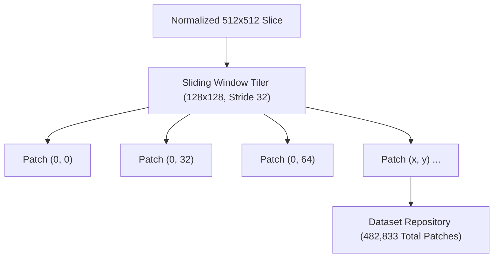

# Medical Image Preprocessing & Radiographic Filtering

[← Main README](../README.md) · [← Architecture Guide](architecture.md) · [← Deep Learning Guide](deep-learning-and-training.md)

This document details the multi-stage biomedical preprocessing pipeline that prepares clinical Computed Tomography (CT) scans for deep learning vertebrae segmentation.

---

## 1. Radiographic Preprocessing Pipeline

Clinical CT scans present substantial noise, varying scanner intensity ranges, and low contrast between vertebrae and adjacent soft tissues or non-vertebral bones. To produce standardized, high-quality inputs for the neural network, our methodology implements a four-step sequence:


### Step 1: Volume Normalization to $[0, 255]$
The volumetric CT scan is first scaled and normalized to a standardized integer range of $[0, 255]$. This standardizes intensity distributions across different scanner manufacturers (Siemens, GE, Philips) and imaging protocols.

### Step 2: Conversion to $512 \times 512$ 2D Slices
The 3D volumetric array is sliced along the axial plane into discrete 2D images with dimensions of $512 \times 512$ pixels. This slice-based representation enables manageable memory allocation and parallelized patch generation.

### Step 3: Intensity Thresholding ($< 63 \rightarrow 0$)
Surrounding anatomical structures—such as paraspinal muscles, adipose tissue, internal viscera, and ambient air—exhibit low radiodensity relative to bone.
- All pixels with intensity values below **63** are clamped to **0** (background).
- This thresholding effectively isolates dense bone structures while suppressing non-osseous noise.

### Step 4: Spatial Gaussian Filtering ($3 \times 3$ Kernel)
To refine boundary edges and eliminate high-frequency scanner noise, a Gaussian filter with a **$3 \times 3$ kernel** is applied across the 2D slices. This smooths voxel intensity transitions and controls noisy pixels without blurring critical cortical bone contours.

---

## 2. Radiographic Challenges in Spinal Vertebrae Imaging

Segmenting the full vertebral column (cervical, thoracic, and lumbar vertebrae) presents four distinct failure modes for classical computer vision:

1. **Intra-Vertebral Density Heterogeneity**:
   - Every vertebra consists of an outer shell of hyperdense **cortical bone** encasing a porous core of **trabecular bone**. Simple global thresholding creates hollow "donut" masks that miss the vertebral body, pedicles, and spinous processes.
2. **Neighboring Rib & Pelvic Bony Contiguity**:
   - In thoracic slices, ribs articulate directly with transverse processes and costal facets. In lumbar and sacral regions, the spine connects to the pelvis. These adjacent non-vertebral bones exhibit identical radiodensity, defeating naive connected-component algorithms.
3. **Beam Hardening & Metallic Artifacts**:
   - High-density surgical pedicle screws, titanium cages, dental amalgams, and dense shoulder musculature cause photon starvation, producing severe streak artifacts across spinal scans.
4. **Partial Volume Effects**:
   - In CT acquisition with slice thickness $\ge 1.0\text{ mm}$, voxels spanning bone-soft tissue boundaries average the two densities, creating blurred interfaces at facet joints, neural foramina, and intervertebral discs.

---

## 3. Advanced Hounsfield Calibration $[100, 1100]\text{ HU}$

In addition to $[0, 255]$ scaling, the codebase (`PreProcessing.py`) supports native physical Hounsfield Unit (HU) windowing:

```python
# Radiodensity windowing formulation (PreProcessing.py)
min_hu = 100
max_hu = 1100
volume = np.where((volume >= min_hu) & (volume <= max_hu), volume, 0)
```

- **Lower Gate ($100\text{ HU}$)**: Completely eliminates paraspinal muscle ($50–65\text{ HU}$) and fluid while preserving low-density trabecular bone ($>120\text{ HU}$).
- **Upper Gate ($1100\text{ HU}$)**: Normal cortical bone rarely exceeds $1050\text{ HU}$. Capping at $1100\text{ HU}$ eliminates extreme metallic hardware flares that would otherwise distort min-max normalization.

---

## 4. Patch Extraction Module (PE-Module)

Once slices are preprocessed, the **PE-Module** extracts $128 \times 128$ overlapping patches using a **32-pixel stride**:



### Dataset Partitioning:
- **Total Patches**: **482,833**
- **Training Set (80%)**: **386,266 patches**
- **Validation Set (20%)**: **96,567 patches**
- **Independent Test Sets**: **5 patient volumes (3,418 slices)**

Related: [Architecture](architecture.md) · [Deep Learning Results](deep-learning-and-training.md) · [3D Reconstruction](3d-volumetric-reconstruction.md)
